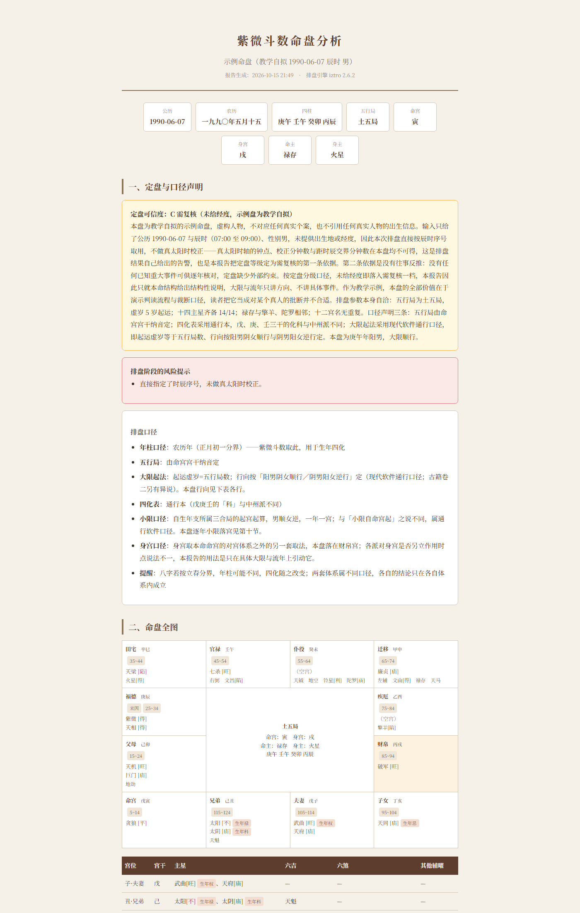

# 紫微斗数排盘与解盘 Skill（ziwei-doushu）

**一个把「可计算的部分」和「需要判断的部分」分开的紫微斗数工具。**

排盘、四化、自化、三方四正、夹宫、大限流年岁数表 —— 全部由脚本算出，逐字段可核对；
AI 只负责真正无法代码化的那部分：定盘、取舍、层次权衡、取象收敛、语气与边界。
输出是一份带**四道自动闸门**的 HTML 分析报告。

```
脚本算确定的  ·  AI 做不确定的  ·  闸门确保两者一致
```



> 上图为示例输出。示例盘是**教学自拟盘（1990-06-07 辰时 男）**，虚构人物，不对应任何真实个案。

---

## 目录

- [这是什么](#这是什么)
- [设计原则](#设计原则)
- [快速开始](#快速开始)
- [排盘：四条命令](#排盘四条命令)
- [出报告：AI 分析 → 脚本渲染 → 四道闸门](#出报告ai-分析--脚本渲染--四道闸门)
- [四道闸门](#四道闸门)
- [项目结构](#项目结构)
- [排盘口径声明（重要）](#排盘口径声明重要)
- [为什么把事实层交给脚本](#为什么把事实层交给脚本)
- [常见问题](#常见问题)
- [免责声明](#免责声明)
- [许可证](#许可证)
- [English](#english)

---

## 这是什么

一个 **Agent Skill**：当用户给出出生日期时间（可能还有地点、性别）要求排盘、解盘、批命、看大限流年时，
AI 按 `SKILL.md` 的八步工作流调用本仓库的脚本，最后产出一份 HTML 报告。

它同时也可以**脱离 AI 单独使用** —— `scripts/ziwei.py` 是一个完整的命令行排盘器。

**能做什么**

- 公历/农历输入、真太阳时校正（给经度）、早晚子时、闰月两派口径
- **多引擎自动选择**：有什么就用什么 —— `x-iztro`（Python，auto 首选）／`iztro`（Node），产出同一份逐字段契约
- 十二宫、十四主星、辅佐煞杂曜、庙旺、生年四化、离心/向心自化、三方四正、夹宫、大限/小限/流年岁数表
- 十七项常见格局的**构成条件判定**（成不成格由 AI 裁断，脚本只回答条件是否满足）
- 机器自检：十二宫名唯一、十四主星齐备、禄存与羊陀相邻、行向与限序一致
- 结构化 JSON / 人读树状盘 / Markdown 表格 / 四柱双口径对照
- 双引擎逐字段比对：`engines --compare N` 随机盘回归 + `engines --leap-sweep A-B` 确定性闰月穷举，不一致数应为 0
- AI 填结构化分析 → 脚本渲染 HTML（内嵌 CSS、十二宫方阵、格局表、逐宫、大限流年、结论与建议、技术留痕折叠区）
- 三道脚本闸门 + 一道独立审查闸门

---

## 设计原则

| 层 | 谁负责 | 内容 |
|---|---|---|
| **事实层**（可推导） | **脚本** | 真太阳时与时辰判定、宫位/星曜落宫与庙旺、四化落点、自化、三方四正与夹宫关系、星曜配对、格局构成条件、大限十二宫映射、各类计数、免责声明与口径声明 |
| **判断层**（无法代码化） | **AI** | 定盘反推、多解取舍、格局裁断与层次、破格/救格的论证、取象轻重与人生主题收敛、语气与边界 |

**硬约束：AI 不得心算，不得凭记忆说「某星应在某宫」。** 凡进入报告的事实，都来自脚本字段
（`palaceRelations` / `decadalPalaceMaps` / `patternCandidates` / `pairingFacts` 等），
报告里的「宫位关系表」「六吉六煞配对表」「大限十二宫落本命表」「大限四化落点表」都由脚本直接渲染，正文只能引用。

---

## 快速开始

**环境要求**：**Python 3.8+，且具备以下之一** —— Node.js 18+（iztro）／`pip install x-iztro`。
两条排盘引擎路任装其一即可用（Windows / macOS / Linux 均可）。

```bash
git clone https://github.com/<你的用户名>/ziwei-doushu-skill.git
cd ziwei-doushu-skill

# 首次：按需给两条引擎路都铺好（先 pip install x-iztro，失败再 npm install iztro）
python scripts/ziwei.py deps
```

`deps` 只做一次，之后离线可用。pip 失败会退回 npm（受限网络下依次尝试默认缓存 → 目录内本地缓存 → 环境代理）；
也可用环境变量覆盖可执行文件：`ZIWEI_NODE` / `ZIWEI_NPM`。

### 多引擎：有什么就用什么

**不替换任何既有路径**：原来的 `iztro`（Node）原样保留，新增 `x-iztro`（Python）作为并列的一条路。

| 路 | 组件 | 形态 | 安装 |
|---|---|---|---|
| `python` | `x-iztro` | 同进程调用，无子进程、不依赖 Node | `pip install x-iztro` |
| `node` | `iztro@2.6.2` | `node engine.js`，stdin/stdout JSON | `python scripts/ziwei.py deps` |

**auto 优先级：先 python，再 node。** 两条都没有时报 `NO_ENGINE` 并给出安装指引。

```bash
# 探测：哪条可用、版本、auto 会选谁
python scripts/ziwei.py engines

# 双引擎回归：各排 200 张随机盘（随机日期/时辰/性别，覆盖闰月、早晚子时、六种五行局）
# 逐字段比对 astrolabe 结构，输出不一致条数与首个差异样例
python scripts/ziwei.py engines --compare 200

# 确定性闰月穷举（随机抽样抽到「阳历生日落在闰月内」的概率约 1%，所以它查不出
# solar 路 fixLeap 写不写死这类口径差）：按天扫 1995–2030，找出**每一个闰月**，
# 覆盖其第 1/中间/最后一天 × 时辰{早子,午,晚子} × 性别{男,女} × fixLeap{true,false}
# 比对结果与覆盖数见 compare.coverage.leapSweep*，mismatches 必须为 0
python scripts/ziwei.py engines --leap-sweep 1995-2030

# 指定引擎（auto 之外的显式选择）
python scripts/ziwei.py chart --date 1990-06-07 --tx 4 --gender 男 --engine python
python scripts/ziwei.py chart --date 1990-06-07 --tx 4 --gender 男 --engine node
```

`astrolabe` 的字段结构是**引擎契约**：两条路产出逐字段相同的结构，上层归一化代码对它们一视同仁。
唯一例外是 `jieqiPillar`（立春口径四柱）——只有 node 路的 lunar-lite 能提供，
python 路如实返回 `null` 并在 `meta.engineNotes` 写明，**不伪造**；`pillar` 子命令会自动回退到 node 取该字段。

> **怎么自己验证两条引擎一致**：`--compare 200` 是随机抽样，够快但**覆盖不到闰月**
> （阳历生日落在闰月内的概率约 1%）；要卡死口径差就跑 `--leap-sweep 1995-2030`，
> 它按天扫描、把每个闰月的首/中/末日 × 早子·午·晚子 × 男女 × `fixLeap` 两取值全部对拍，
> 输出 `compare.coverage.leapSweep*` 里的覆盖数与 `mismatches`（必须为 0）。
> 两个参数可以合用：`python scripts/ziwei.py engines --compare 200 --leap-sweep 1995-2030`。

> 注：`node_modules/iztro` 与 `x-iztro` 均遵循各自原始 MIT 许可；本仓库自身许可见 [许可证](#许可证)。

---

## 排盘：四条命令

```bash
# ① 人读：树状盘面
python scripts/ziwei.py tree  --date 1990-06-07 --tx 4 --gender 男 --year 2026

# ② AI 读：完整 JSON（盘面 + 四化/自化 + 关系 + 大限 + 自检）
python scripts/ziwei.py chart --date 1990-06-07 --tx 4 --gender 男 --year 2026

# ③ 贴文档：Markdown 十二宫表
python scripts/ziwei.py md    --date 1990-06-07 --tx 4 --gender 男

# ④ 四柱双口径对照（农历年 vs 立春，年干不同会换掉全部生年四化）
python scripts/ziwei.py pillar --date 2000-04-22 --time 19:30 --lng 116.41 --gender 女
```

**参数**

| 参数 | 说明 |
|---|---|
| `--date` | 出生日期，支持 `1990-06-07` / `1990/6/7` / `1990年6月7日` |
| `--lunar` | 把 `--date` 当农历 |
| `--tx` | 只知道时辰时直接用序号：`0`=早子(00:00–00:59) `1`=丑 … `11`=亥 `12`=晚子(23:00–23:59) |
| `--time` + `--lng` | 给钟点与出生地经度，脚本做**真太阳时校正**后定时辰（强烈建议） |
| `--gender` | `男` / `女` |
| `--year` | 要看流年的公历年份，可多个：`--year 2026,2027` |
| `--engine` | 排盘引擎：`auto`（默认，先 python 再 node）／`python`（x-iztro）／`node`（iztro） |
| `--pretty` | JSON 缩进输出 |

> **出生地不是可选项。** 真太阳时校正会实打实挪动时辰——同一钟点在不同经度可能差一到两个时辰，
> 整张盘的命宫、身宫与十四主星会全部错位。缺经度时脚本会给出 `meta.warnings`，报告必须转述。

---

## 出报告：AI 分析 → 脚本渲染 → 四道闸门

```bash
# ① 生成分析工作单（盘面事实已预填，AI 的注意力留给判断）
python scripts/prepare_template.py --chart chart.json --output analysis.json

# ② 【AI 分析】严格顺序：先填九步留痕与关键发现，再写成文，最后逐项裁断格局
#    脚本会检查 interpretation_notes（九步各 ≥40 字）与 findings——跳过分析直接拼字段会被拒

# ③ 渲染 HTML（内嵌 CSS，可直接打开或归档）
python scripts/generate_report.py --chart chart.json --analysis analysis.json --output report.html

# ④ 三道脚本闸门（都要退出码 0）
python scripts/generate_report.py --chart chart.json --analysis analysis.json --validate
python scripts/check_report_language.py report.html
python scripts/audit_report.py --chart chart.json --report report.html

# ⑤ 自测：验证闸门本身没坏（夹具：干净用例 + 近 30 项「应被检出」的错误）
python scripts/test_audit.py --chart examples/sample-chart.json --report examples/sample-report.html
```

AI 只产 `analysis.json`，**HTML 由脚本渲染**：版式稳定、省 token、可校验。

---

## 四道闸门

| 闸门 | 查什么 |
|---|---|
| `--validate` | 字段是否填齐、字数下限、**九步分析留痕是否真做**、可读区语言、格局标成立却没给破格/救格、`verdict`/`advice` 是否空着占位 |
| `check_report_language` | 对**已生成的 HTML** 复查可读区：内部流程词、文件路径、JSON 字段名、Python 字面量、未渲染的 Markdown 星号、写给自己看的自校元指令 |
| `audit_report` | **结论与盘面是否矛盾**：星曜错位、三方四正误判、夹宫误判（同宫不算夹）、宫位关系错（含否定式）、大限宫名错、亮度编造、生年四化标记残缺、格局结论冲突、按类别计数不符 |
| **独立子代理审查** | **只审判断层**：裁断规则是否用对、层次依据、破格/救格论证力、取象是否超出盘面、边界与伦理、建议是否越界 |

当前测试规模：审查器夹具 **33/33**、语言规则自测 **42/42**、报告板块完整性 **11/11**。

规则见 [`references/review-gate.md`](references/review-gate.md)：**事实交给脚本、判断交给审查，一轮为限**；
同类判断问题第二次出现，就说明它其实可代码化 —— 应补成检测器与夹具，而不是靠下一轮审查再抓。

---

## 项目结构

```
SKILL.md                      Agent 的八步工作流（触发后读这个）
README.md                     本文件
references/
  interpretation.md           解盘规则、格局层次、效力层级尺、10 类必须并列的流派分歧、定盘反推
  report-schema.md            analysis JSON 字段契约、字数下限、语言闸门禁用词
  report-template.md          报告语气规范、伦理模板、交稿自检清单
  review-gate.md              独立审查的规则与可直接复制的提示词
  glossary.md                 排盘公式、术语表、iztro / x-iztro API 备忘、依赖信任说明
scripts/
  ziwei.py                    统一 CLI：deps / engines / chart / tree / md / pillar
  engine.js                   iztro 计算引擎（node 路，Python 经 stdin/stdout 调用）
  prepare_template.py         由 chart 生成分析工作单
  generate_report.py          AI 产 JSON → 渲染 HTML + --validate 闸门
  check_report_language.py    成品可读区语言验收（--self-test 自带夹具）
  audit_report.py             结构审查器：结论与盘面是否矛盾
  test_audit.py               审查器自测夹具（33 项）
  ziwei_doushu/
    astro.py                  真太阳时、干支纳音、四化、自化、关系、格局条件、岁数表
    chart.py                  编排层 + 跨平台依赖与进程管理
    engines.py                多引擎调度层：detect() 探测 + run() 统一调用（auto/python/node）
    engine_py.py              x-iztro 计算引擎（python 路，映射成与 engine.js 逐字段相同的结构）
    render.py                 树状盘面与 Markdown 渲染
examples/
  sample-chart.json           示例盘面数据（教学自拟 1990-06-07 辰时 男）
  sample-analysis.json        平铺分析 JSON（配 --chart）
  sample-bundle.json          合并包（配 --input，含全文附录）
  sample-report.html          渲染成品
  workorder-template.json     分析工作单模板
docs/
  sample-report.png           示例报告截图
  ziwei-03-verification.md    排盘口径的核验记录（含公式推导与交叉验证）
```

---

## 排盘口径声明（重要）

紫微斗数各家口径不一，本工具**把口径做成显式声明**，而不是悄悄选一个：

| 口径 | 本工具取值 | 备注 |
|---|---|---|
| 五行局 | 由**命宫宫干纳音**定 | 另一派用生年干推月支纳音，会得到不同局 |
| 年柱分界 | **农历年**（正月初一） | 八字按立春分界，年干可能不同 → 生年四化整套改变，两套体系不可混用 |
| 四化表 | **通行本** | 戊、庚、壬三干的「化科」与中州派不同；本工具支持整表覆盖 |
| 大限行向 | **阳男阴女顺行 / 阴男阳女逆行** | 现代软件通行口径；古籍卷二另有「从命前一宫起」之说 |
| 大限十二宫名 | 与本命**同向排布**，与行向无关 | 曾有人把行向套到宫名表上，导致顺行盘整表错位 |
| 小限 | 自生年支所属三合局的起宫起算，男顺女逆 | 与「小限自命宫起」之说不同 |
| 真太阳时 | 需**经度**，不内置地点库 | 缺经度则按时辰序号直取，并在报告中声明 |
| 亮度（庙旺利陷） | 采用单一来源，报告内声明版本差异 | 不同底本的庙陷表存在出入 |
| 格局 | 脚本只判**构成条件**，成不成格由 AI 裁断并给层次与破格/救格 | — |

排盘口径的推导与交叉验证见 [`docs/ziwei-03-verification.md`](docs/ziwei-03-verification.md)。

---

## 为什么把事实层交给脚本

这不是洁癖，是踩出来的。本项目在一个示例报告上连做了多轮独立盲审，把发现的问题归类后发现：

> **约九成的错误，是「可推导的事实被手写进散文」** —— 星曜错位、大限宫位算术、计数不符、术语误用；
> 只有约一成是真正的判断问题（层次、循环论证、破格概念误用、建议越界）。

于是有了现在的分工：**凡是脚本能算的，AI 不许写**；凡是 AI 必须判断的，脚本只提供事实、不下结论。
连带产出的几处真实修复：

- 有人把「大限行向」套到「限内宫名排布」上，导致所有顺行盘的宫名表整体错位 → 已用引擎自身的
  `horoscope().decadal.palaceNames` 在 4 张盘 × 2 个限上逐格验证并回退；
- `verdict`（总评）与 `advice`（宜忌）曾长期「被校验、被扫描、却从未渲染」→ 已补成「结论与建议」章，
  并列入必填板块（缺则校验失败）；
- 三合满足但不在命宫三方四正的格局曾被标「成立」→ 现在是 `audit_report` 的硬性拦截项。

---

## 常见问题

**Q：一定要用 AI 吗？**
不用。`scripts/ziwei.py` 是完整的命令行排盘器，`prepare_template.py` 生成的分析工作单也可以人工填写，
只要过得了三道脚本闸门，就能渲染出报告。

**Q：`deps` 装了什么？**
按需给两条路都铺好：先 `pip install x-iztro`（Python 路，MIT），失败再
`npm install iztro@2.6.2`（Node 路，MIT）到本目录的 `node_modules/`——不写全局、不改你的其它项目。
两条装好时 `auto` 走 python（同进程、更快、不依赖 Node）。

**Q：为什么报告是 HTML 而不是直接输出文字？**
版式稳定、可校验（语言闸门与结构审查都作用在成品上）、可归档，也便于把「技术留痕」折叠起来给复核者看。

**Q：结果和其他排盘软件不一致？**
先看 [排盘口径声明](#排盘口径声明重要)——年柱分界、四化表、大限起法、闰月与早晚子时都可能造成差异。
`pillar` 命令专门用来对照农历年与立春两套年柱。

**Q：能直接用来算命吗？**
请看下面的免责声明。本项目的定位是**结构化工具与流程演示**，不是断言任何人的命运。

---

## 免责声明

本项目产出的是**命理与自我观察内容，仅供参考**，需与实际条件交叉判读；
**不构成投资、财务、医疗、诊断、法律或其他专业建议**，必要时请咨询合格专业人士。

`SKILL.md` 与 `references/` 对 AI 的产出设有硬边界：不得预测死亡时间、不得下绝症诊断、不得劝阻就医、
不得给出投资或法律结论；健康与财务内容只能作结构性提醒，徵验类断语必须附「徵验率因人而异」声明。

---

## 许可证

**个人免费使用，商业使用需付费授权** —— 完整条款见 [LICENSE](LICENSE)。

| 用途 | 是否收费 |
|---|---|
| 个人自用、学习、研究、教学与非营利项目 | **免费**（保留版权声明与许可协议即可） |
| 公司/机构内部业务系统、收费产品与服务、咨询与报告经营、托管/API/SaaS | **需事先取得商业授权**（提交 Issue，标题注明「商业授权」） |

这不是 OSI 认可的开源许可证，因此 GitHub 不会在仓库页显示 License 徽章——这是预期行为。
运行时使用到的第三方组件（iztro、x-iztro 等）各自遵循其原始 MIT 许可，见 [LICENSE](LICENSE) 第四条。

---

## English

**ziwei-doushu** is an Agent Skill (and a standalone CLI) for Zi Wei Dou Shu (Purple Star Astrology).

The design principle is a strict split of labour: **everything computable is done by scripts**
(chart casting, solar-time correction, four transformations, self-transformations, palace relations,
major/minor limit tables, pattern *conditions*), while **the LLM only does what cannot be coded**
(chart verification, adjudication, weighting, phrasing, ethics).

Output is an HTML report that must pass four gates: field/analysis validation, readable-area language check,
a structural auditor that cross-checks every claim against the chart data, and an independent review pass
that only judges the interpretive layer.

**Engine selection**: two interchangeable chart-casting engines, no path removed — `x-iztro` (Python,
preferred by `auto`, in-process, no Node needed) and `iztro` 2.6.2 (Node, the original path).
Both emit a byte-for-byte identical `astrolabe` contract; run `python scripts/ziwei.py engines --compare 200`
to assert it over 200 random charts, and `python scripts/ziwei.py engines --leap-sweep 1995-2030`
for a **deterministic leap-month sweep** (random sampling hits a leap-month birthday only ~1% of the
time, so it cannot catch solar-path convention drift). The single field only the Node path can supply
is `jieqiPillar` (solar-term four pillars) — the Python path returns `null` and says so in `meta.engineNotes`.

**Requirements**: Python 3.8+, plus either Node.js 18+ (iztro) or `pip install x-iztro`.
Run `python scripts/ziwei.py deps` once, then see [快速开始](#快速开始) for usage.
The sample chart is a synthetic teaching example, not a real person.

Conventions differ between schools; every convention used here is declared explicitly in the report
(see [排盘口径声明](#排盘口径声明重要)). This project is for study and tooling — it does not diagnose,
advise medically or financially, or predict anyone's fate.
